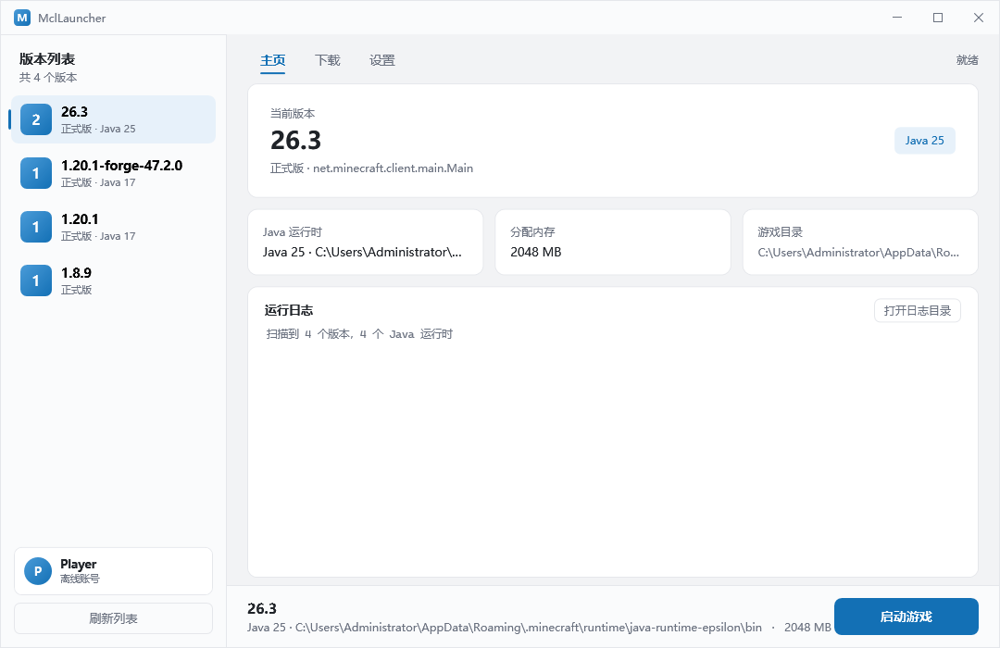
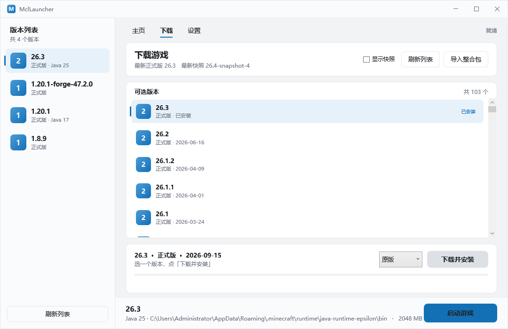

# MclLauncher

PCL2 风格的 Minecraft 启动器。C# / WPF / .NET 8，单文件 250 KB。

| 主页 | 下载 |
|---|---|
|  |  |

## 现在能干什么

**启动**
- 扫描 `versions/*/*.json`，列出本地所有版本（含整合包实例）
- 自动找 Java：游戏自带 `runtime/` → `JAVA_HOME` → `PATH` → `Program Files` 各发行版，
  按版本要求挑**最低可用**的版本（26.3 会自动挑到 runtime 里的 Java 25）
- 完整启动链路：rules 过滤 → classpath → natives 解压 → 占位符替换 → 进程管理 → 实时日志
- **账号**：左侧栏点头像切账号
  - 离线登录立即可用，UUID 按 Mojang 规则由用户名本地生成
  - 微软正版默认走**网页登录**：开系统默认浏览器打开微软登录页，直接输邮箱 + 密码；
    授权码经本地回环地址（`http://localhost:<随机端口>/`）回传，state 防串台。
    回环**主机名必须和应用注册里的一致**（微软只忽略端口，`localhost` 与 `127.0.0.1` 算两个地址），
    所以登录前会先探测一次，两个主机名都挂监听，哪个能过用哪个
  - 设备码登录保留为备用按钮
  - **自建 client_id 的上限**：Mojang 对第三方应用调用 Java 游戏 API 做人工白名单审核
    （官方说明 aka.ms/AppRegInfo），新注册的 ID 能走完微软登录 → Xbox Live → XSTS，
    但最后一步换 Minecraft 令牌会被 `403 Invalid app registration` 拒掉。
    需先提交 https://aka.ms/mce-reviewappid 审核；PCL2 / HMCL 等老牌启动器早已在名单内
  - 令牌 24 小时过期前自动用 refresh_token 续

**下载**
- 从 Mojang 拉版本列表（正式版 / 快照可切换），一键下载安装
- 下载内容：version JSON、client jar、libraries、assetIndex、assets 对象、natives
- 并发 32 路 + sha1 校验 + hash 对上直接跳过（等价断点续传）
- **加载器**：下拉切换 原版 / Fabric / Forge
  - Fabric：读 meta profile JSON，不跑 installer
  - Forge：跑官方 installer `--installClient`，再补齐剩余库
- **自动刷新（PCL 同款）**：启动即预加载——停在主页时就在后台拉好版本列表和整合包首页，
  之后每 3 分钟静默刷新一次；点进下载页 / 在线整合包时数据已就位，无需等待
  - 版本列表：刷新 Mojang manifest；在线整合包：预加载第一页，之后停留在用户所在页刷新
    （不会把人冲回第一页）
  - 右上角「自动刷新」勾选可关，旁边显示倒计时
  - 静默刷新只更新底部状态行（已刷新时间），翻页 / 搜索 / 安装时自动让路
  - `--shot --preload` 调试参数可无头验证该时序（停主页 4.5 秒后模拟点进下载页）

**整合包**
- **在线浏览**：下载页切到「在线整合包」，拉 CurseForge 官方库的整合包列表
  （按热度排序、可搜索、显示下载量，**需要 API key**，在设置里填）
- 分页：单页上限 50（实测 pageSize=100 直接报错），列表底部「上一页 / 下一页」按 `index`
  翻页并显示「第 X / Y 页」；CurseForge 侧整合包总量上万（API totalCount 上限 10000，
  即最多 200 页），翻页替换列表内容
- 本地导入：**CurseForge `.zip`**
- 流程：自动装原版 → 装加载器（Fabric / Forge）→ 下 mod → 铺 overrides
- CurseForge 的 `manifest.json` 只给 projectID/fileID，文件名靠社区镜像反查，
  再用 Forge CDN 命名规则拼下载直链
- 每个整合包是**独立实例**（`versions/<实例名>` 作为 gameDir），mods 不会互相污染
- Fabric 加载器不需要跑 installer jar，直接读 meta 接口的 profile JSON

## 实测记录

| 项目 | 结果 |
|---|---|
| 安装 26.3 | **22 秒**，5147 个资源对象，客户端 41 MB，磁盘 2.0 G → 2.3 G |
| 启动 26.3 | 成功，自动选中 `runtime/java-runtime-epsilon` 的 Java 25，材质图集全部建成 |
| 启动 1.8.9 | 成功，走老格式 `minecraftArguments`，Java 8 |
| 安装 Forge 1.20.1-47.2.0 | 跑官方 installer，生成版本 JSON + 25 MB 库 |
| 启动 Forge 1.20.1 | 成功，`inheritsFrom` 合并后 classpath 100 个 jar，进主菜单 |
| 离线 UUID | 与 Java `UUID.nameUUIDFromBytes("OfflinePlayer:Player")` 完全一致 |
| CurseForge 文件解析 | `project 238222` / `file 9255810` → `jei_1.12.2-4.22.0.1037.jar`，CDN 直链 HTTP 200、715519 字节 |
| CurseForge 官方 files | key 有效；`9255810` → `jei_1.12.2-4.22.0.1037.jar`，`edge.forgecdn.net` 200、715519 字节 |
| CurseForge 官方 search | 组织 key 实测稳定 200（2026-10）；曾因误存失效 key 出现 403，已改为单一 CurseForge 源，失败直接报错 |
| CurseForge manifest 解析 | `manifest.json` → mc/loader/files 全字段正确 |
| 自动刷新 | `--shot --download` 无头验证：进入下载页自动拉取 103 个版本；`--shot --modpacks` 自动拉取 CurseForge 第 1 页 |

## 运行

```
双击 publish/MclLauncher.exe
```

需要 **.NET 8 Desktop Runtime**。开发时 `dotnet run`。

调试参数：

| 参数 | 作用 |
|---|---|
| `--shot` | 窗口渲染成 `shot.png` 后退出（UI 回归） |
| `--shot --download` | 截下载页 |
| `--dry-run` | 只拼启动命令，结果写 `dryrun.txt` |
| `--install <版本>` | 命令行安装指定版本，进度写 `install.log` |

## 代码结构

```
Core/
  Models.cs           版本 JSON 包装、Library / Rule 解析
  Rules.cs            rules 顺序覆盖判定 + 平台识别
  VersionResolver.cs  inheritsFrom 父子合并（Fabric/Forge 必需）
  VersionScanner.cs   扫描本地版本
  GameBuilder.cs      classpath / natives / 命令行拼装
  JavaRuntime.cs      Java 探测与版本识别
  GameLauncher.cs     进程启动、日志回调
  ManifestService.cs  version_manifest 缓存与解析
  AccountStore.cs    账号持久化 + 离线 UUID 生成
  Auth.cs            微软登录五级链路 + token 刷新
  Installer.cs        原版安装：jar / libraries / assets / natives
  FabricService.cs    Fabric 加载器安装（meta profile JSON）
  ModpackInstaller.cs CurseForge .zip 导入 + 版本隔离实例
  Downloader.cs       并发下载 + sha1 校验 + 断点跳过
  Auth.cs             微软登录五级链路
ViewModels/
  MainViewModel.cs    主界面
  DownloadViewModel.cs 下载页
  VersionItem.cs      版本卡片
Themes/Styles.xaml    配色、按钮、卡片、进度条、滚动条
MainWindow.xaml       主界面
```

## 几个关键实现

**1. rules 是顺序覆盖，不是「或」**

```csharp
var allowed = false;
foreach (var rule in rules)
    if (Matches(rule)) allowed = rule.Action == "allow";
```

`[{allow}, {disallow, os:osx}]` 在 macOS 上结果是 false。

**2. natives 必须解压**

`natives-*.jar` 里的 dll 不能留在 jar 里，JVM 不会去 jar 里找本地库。

**3. 老版本的 `${user_properties}`**

1.8.x 的 `minecraftArguments` 带这个占位符，漏了直接崩，固定填 `{}`。

**4. `inheritsFrom` 必须合并**

Fabric 的版本 JSON 只有 `mainClass` + 自己的库，其余全靠 `inheritsFrom` 指向原版。
合并顺序：libraries **子在前父在后**，arguments 同理，`jar` 字段指回原版。

**5. 版本隔离靠 gameDir**

版本目录里出现 `mods/` / `config/` / `options.txt` 就判定为独立实例，
启动时 `--gameDir` 指向它。这是整合包不互相污染的关键。

**6. 参数用 `ArgumentList` 而不是拼字符串**

路径有空格时自动加引号。

**7. Forge 有两个必须知道的坑**

- **installer 不写原版 JSON**。它只把原版 jar 拖下来，`versions/1.20.1/` 里只有 jar。
  没有那个 JSON，`inheritsFrom` 就找不到父版本，合并失败、Java 需求退化成 8。
  所以装 Forge 前必须先跑一遍原版安装。
- **client jar 必须复制成 `<version-id>.jar`**。Forge 的 `-DignoreList` 里写的是
  `${version_name}.jar`，如果让 classpath 指回 `1.20.1.jar`，它不在忽略列表里，
  会被模块系统当成两个模块加载同一个包：
  `Module minecraft contains package net.minecraft.server, module _1._20._1 exports ...`
  直接 `ResolutionException`。复制一份改名最省事。

**8. CurseForge 三层降级**

king 提供了 API key，实测后确认了三条路径，按可靠性排序：

1. **官方 `/mods/{id}/files`**（要 key）— 直接返回 `downloadUrl`，最可靠。
   实测 `project 238222 / file 9255810` → `jei_1.12.2-4.22.0.1037.jar`，
   `edge.forgecdn.net` 200、715519 字节。
2. **社区镜像 + CDN 命名规则**（免 key）— `api.cfwidget.com` 拿 `fileName`，再拼
   `mediafilez.forgecdn.net/files/{fileId/1000}/{fileId%1000}/{fileName}`。目前仍可用。
3. **官方 `/mods/search`**（要 key）— 在线整合包的**唯一**来源。2026-10 实测组织 key
   稳定 200；此前记录的"普通 key 403"实为误存了失效/被限流的 key，不是端点权限问题。
   搜索失败直接报错，不再降级到其他平台。

三个响应结构的坑，全是实测撞出来的：

- `/v1/categories` 和 `/v1/mods/{id}/files` 返回的是 `{ "data": [...] }`，**不是裸数组**，
  按裸数组解析会静默拿到 null。
- `manifest.json` 的 `modLoaders` 元素是**对象**（`{"id": "...", "primary": true}`），
  不是字符串。
- CurseForge 的 manifest 不带文件名也不带落盘路径，目标目录按项目类型推断
  （mod → `mods/`、resourcepack → `resourcepacks/`、shader → `shaderpacks/`）。

**9. 在线整合包只有 CurseForge 一个源**

已移除 Modrinth 通路（`ModrinthService.cs` 及各处回退逻辑）。在线搜索必须填
CurseForge API key（设置 → CurseForge API key），没填直接提示；请求失败如实报错，
不再静默换平台。本地导入同样只支持 CurseForge `.zip`（`manifest.json` 结构）。

CurseForge 的 classId **不硬编码** —— Modpacks 的类别 id 各时期会变，写死一旦变了搜索就
静默返回空数组，根本看不出是 id 错了。所以先拉 `/v1/categories?gameId=432`，按
slug 找 `modpacks` 再拿它的 id 去搜。搜索和 CDN 下载都带 `x-api-key`（归属统计，
官方已公告强制鉴权）。

## 还没做

| 功能 | 状态 |
|---|---|
| NeoForge / Quilt | 未接 |
| Modrinth 支持 | 已按需求移除，在线/本地导入仅保留 CurseForge 单源 |
| token 明文存储 | `mcl_accounts.json` 里的 refresh_token 没加密，建议换 DPAPI |
| 模组 / 存档管理 | 未开始 |
| 主题切换 | 配色已抽成资源，缺切换逻辑 |
| 多游戏目录 | 固定读 `%APPDATA%\.minecraft` |
